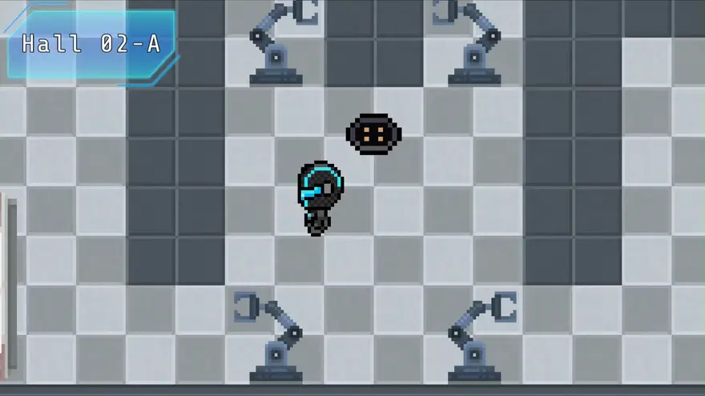
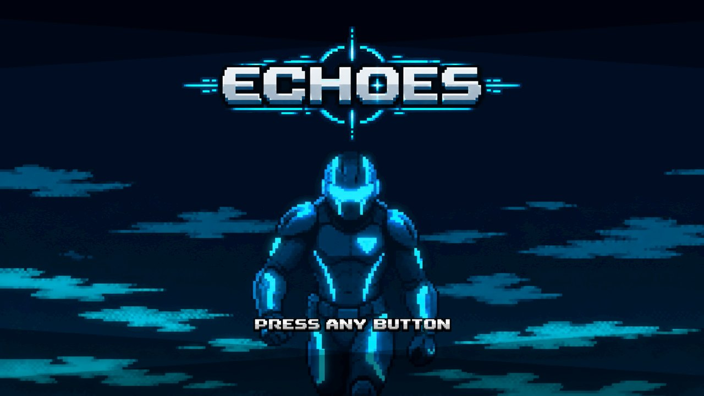
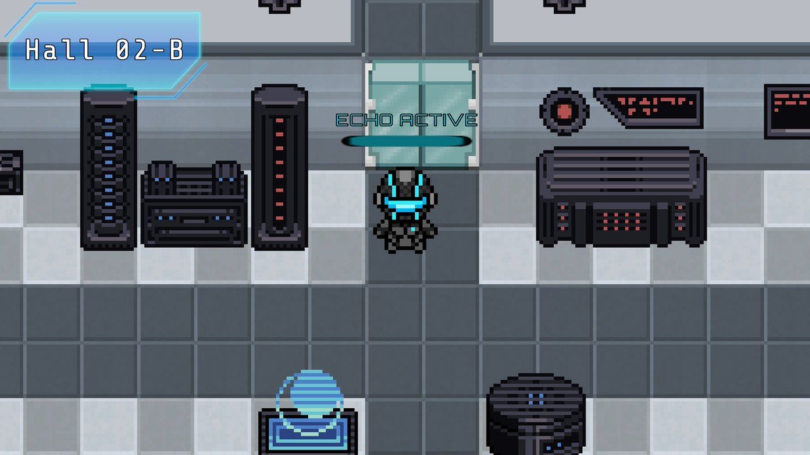

<div align="center">

# 🎧 ECHOES

**Juego 2D de puzles y sigilo en el que grabas tus propios movimientos y los reproduces como un eco que actúa por ti**

[]()
[]()
[]()
[]()

</div>

---

## 📖 Sobre el proyecto

**ECHOES** es un juego de puzles y sigilo visto desde arriba. Encarnas al *Sujeto E-0*, que se abre paso por un complejo de entrenamiento con ayuda de una voz que lo guía, **Ir1s**. La idea central es el **eco**: grabas unos segundos de lo que haces y lo sueltas en la sala como una copia tuya que repite exactamente tus pasos y tus interacciones. Así puedes estar en dos sitios a la vez: el eco pisa una placa mientras tú cruzas la puerta que abre.

> 📌 **Trabajo de Fin de Estudios (TFE)** del *Máster en Diseño y Desarrollo de Videojuegos* de la **UNIR**. Los diálogos del juego están en inglés.

---

## 🖼️ Capturas

<p align="center">
  
</p>

<p align="center">
  
  
</p>

<p align="center"><em>Pantalla de título y la sala Hall 02-B con el eco activo. Sobre el personaje, un indicador con barra muestra el estado del eco: <code>RECORDING</code>, <code>ECHO READY</code> o <code>ECHO ACTIVE</code>. Estética pixel art futurista.</em></p>

---

## 🎮 Cómo se juega

1. **Muévete por las salas** y resuelve cada una para abrir el paso a la siguiente.
2. **Graba un eco** hasta 15 segundos. Todo lo que hagas en ese tiempo queda registrado: tu recorrido y cada vez que interactúas con algo.
3. **Despliega el eco**: aparece en el punto donde empezaste a grabar y repite la grabación. No choca contigo, así que no se interpone.
4. **Rebobina** para descartar la grabación y hacer otra. Solo hay un eco a la vez, y no se puede grabar encima de otro sin rebobinar antes.
5. **Evita las cámaras de seguridad**: si una te detecta, aparece la pantalla de detección y la escena se reinicia.

### 🧩 Elementos de las salas

| Elemento | Qué hace |
| :--- | :--- |
| **Eco** | Se desbloquea al interactuar con un panel especial. Repite posiciones e interacciones y se puede observar con su propia cámara. |
| **Paneles y puertas** | Algunos paneles mantienen la puerta abierta de forma permanente; otros solo durante unos segundos. |
| **Placas de presión** | Se activan mientras haya alguien encima: tú, el eco o una caja. Algunas solo responden a una caja grande. |
| **Cajas móviles** | Se empujan por la sala; las grandes sirven para las placas más exigentes. |
| **Puertas automáticas** | Se cierran solas poco después de cruzarlas. |
| **Cámaras de seguridad** | Barren la sala con un cono de visión que las paredes bloquean. Tienen tres estados: patrulla, alerta y detección. Cuanto más lejos estés, más tiempo tardan en detectarte. |

### 🕹️ Controles

| Acción | Teclado | Mando |
| :--- | :---: | :---: |
| Moverse | `W` `A` `S` `D` o flechas | Stick izquierdo |
| Correr | `Mayús` izquierda | Pulsar stick izquierdo |
| Interactuar | `E` | `B` |
| Grabar / detener la grabación | `R` | `A` |
| Desplegar el eco | `Q` | `X` |
| Rebobinar | `F` | `Y` |
| Ver el eco con su cámara (mantener) | `2` | `Select` |

Las opciones permiten ajustar el volumen (general, música y efectos) y reasignar teclas y botones, y los cambios se conservan entre sesiones.

---

## ✨ Qué incluye

- **Sistema de eco** con grabación, despliegue, rebobinado y cámara de espectador.
- **Sigilo** con cámaras de visión cónica y pantalla de detección.
- **Diálogos con la voz de Ir1s**, con pistas de control que muestran la tecla o el botón real según uses teclado o mando.
- **Cinemática de introducción y de final.**
- **Guardado automático** y opción de **continuar** desde el menú del título.
- **Menú de pausa y de opciones** con pestañas, compatible con mando.
- **Música y efectos de sonido** para cada interacción.

---

## 🚀 Cómo ejecutarlo

**Requisitos:** [Unity Hub](https://unity.com/download) y el editor **Unity 6000.3.10f1**.

1. En Unity Hub, *Add → Add project from disk* y elige la carpeta `ECHOES/` de este repositorio.
2. Abre el proyecto con el editor 6000.3.10f1 (la primera vez tarda en importar los assets).
3. Abre la escena `Assets/Scenes/Title.unity` y pulsa **Play**.

No hay una versión compilada publicada.

---

## 🔧 Detalles técnicos

- **Grabación determinista.** Durante la grabación se guarda la posición del jugador en cada paso de física (`FixedUpdate`) y, aparte, cada interacción con su marca de tiempo. El eco es un objeto cinemático que recorre esas posiciones y vuelve a lanzar las interacciones en su momento exacto (`EchoRecorder`, `EchoPlayback`, `RecordingData`).
- **Máquina de estados del eco:** `Idle → Recording → Recorded → Playing`, que es lo que impide grabar encima de una grabación sin querer.
- **Interacciones desacopladas** mediante la interfaz `IInteractable`: puertas, paneles y desbloqueadores la implementan y el eco las dispara igual que el jugador.
- **Detección con grado de alerta** en lugar de un tiempo fijo, para que no se pueda colar uno pegado a la cámara. Hay un margen de gracia tras cargar una sala para evitar bucles de recarga.
- **Diálogos como datos** (`DialogueSequence`) y entrada con el **nuevo Input System**, con las reasignaciones guardadas en `PlayerPrefs`.

---

## 📂 Estructura del repositorio

```
ECHOES_TFE_UnaiGB_UNIR/
├── Media/                       # Capturas y animación del juego
└── ECHOES/                      # Proyecto de Unity
    ├── Assets/
    │   ├── Scenes/              # Title, TrainingCourt y escena de prototipo
    │   ├── Scripts/
    │   │   ├── Echo/            # Grabación, reproducción y animación del eco
    │   │   ├── Player/          # Movimiento, entrada, interacción y animación
    │   │   ├── Interactables/   # Puertas, paneles, placas, cajas y desbloqueador
    │   │   ├── Enemies/         # Cámaras de seguridad y cono de visión
    │   │   ├── Managers/        # Salas, detección, introducción y final
    │   │   ├── Dialogue/        # Sistema de diálogos
    │   │   ├── Saving/          # Guardado y continuar partida
    │   │   ├── Menus/ · UI/     # Título, pausa, opciones y HUD
    │   │   ├── Audio/ · Camera/
    │   ├── Dialogues/           # Diálogos de cada sala
    │   ├── Prefabs/ · Sprites/ · Animations/ · Audio/ · Tiles/
    └── ProjectSettings/
```

---

## 🖥️ Stack tecnológico

| Categoría | Herramientas |
| :--- | :--- |
| **Motor** | Unity 6 (6000.3.10f1) con Universal Render Pipeline 2D |
| **Lenguaje** | C# |
| **Entrada y texto** | Input System · TextMesh Pro |

---

## 🎨 Créditos de terceros

Este repositorio incluye recursos de otros autores, que conservan sus propias licencias: el paquete de interfaz *Sci-Fi UI*, un *tileset* gratuito y la música *Darkvine Music* (Krampus) y *Casualty* (White Bat Audio), según el nombre de los ficheros.

---

## 👤 Autoría

**Unai García** — Máster en Diseño y Desarrollo de Videojuegos (UNIR)

- 🐙 GitHub: [@unaigb](https://github.com/unaigb)
- 🌐 Portfolio: [unaigb.dev](https://unaigb.dev)
